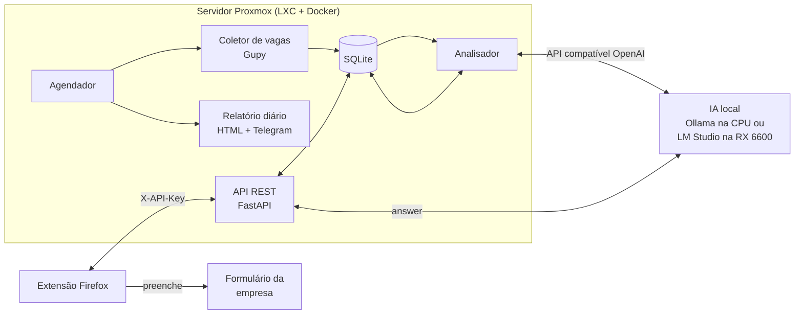

# SearchJob

[](https://github.com/ryanbworks/SearchJob/actions/workflows/ci.yml)


Assistente pessoal de busca de vagas de **suporte técnico, help desk e service desk**, com
**IA rodando localmente** (sem APIs pagas e sem enviar seus dados para terceiros).

Criei este projeto para organizar minha própria busca pelo primeiro emprego em TI. Ele
resolve três problemas reais:

1. **Achar as vagas certas.** Coleta vagas automaticamente e a IA dá uma nota de 0 a 10 de
   aderência ao meu perfil.
2. **Entender o que o mercado pede.** Mostra quais requisitos aparecem com mais frequência,
   para eu priorizar o que estudar.
3. **Candidatar-se mais rápido.** Uma extensão do Firefox preenche os formulários
   repetitivos e sugere respostas para perguntas abertas. A revisão e o envio continuam
   sendo meus.

## Arquitetura



| Parte | Tecnologias | Pasta |
|---|---|---|
| Servidor | Python 3.12, FastAPI, SQLite, APScheduler, httpx, Jinja2 | [`server/`](server/) |
| Extensão | WebExtensions (Manifest V3), JavaScript puro, sem dependências | [`extension/`](extension/) |
| IA | Qwen2.5 / Llama 3.1 via Ollama, LM Studio ou llama.cpp (Vulkan) | [`docs/ia-local.md`](docs/ia-local.md) |
| Infra | Docker, Docker Compose, Proxmox LXC, GitHub Actions | [`docs/deploy-proxmox.md`](docs/deploy-proxmox.md) |

## Funcionalidades

**Servidor**
- Coleta periódica no portal público da Gupy, com paginação, intervalo entre requisições e
  remoção de duplicadas.
- Extração de requisitos por palavras-chave (Windows, AD, redes, ITIL, GLPI…), que funciona
  mesmo sem IA.
- Análise com LLM local: nota de aderência, resumo, requisitos e o que falta no meu perfil.
  Se a IA estiver offline, a análise é adiada sem perder nada.
- Relatório diário em HTML com ranking das vagas e o painel "o que o mercado está pedindo",
  com aviso opcional pelo Telegram.
- API REST documentada (OpenAPI em `/docs`), protegida por chave.
- Acompanhamento de status: nova → candidatado → entrevista → proposta / recusada.

**Extensão do Firefox**
- Reconhece campos por `label`, `aria-label`, `placeholder`, `name` e `autocomplete`,
  inclusive em formulários feitos com React/Vue.
- Preenche nome, contato, endereço, links, formação e pretensões a partir de um perfil
  salvo só no navegador.
- Destaca perguntas abertas e gera respostas com a IA local, com base no perfil e na vaga.
- Marca a vaga como "candidatado" no servidor.

## Decisões de projeto

- **Sem candidatura automática.** A extensão nunca clica em "Enviar". Candidatura em massa
  costuma violar os termos dos sites e gera respostas genéricas, que recrutadores descartam.
- **Privacidade.** O perfil fica no navegador. CPF, RG e senhas não são armazenados. A IA
  roda na rede local.
- **Permissões mínimas.** A extensão usa `activeTab`: só roda na aba atual e somente quando
  o usuário clica.
- **Fácil de estender.** Novas fontes de vagas só precisam implementar o protocolo
  `Collector` ([`collectors/base.py`](server/src/searchjob/collectors/base.py)).

## Começando

```bash
git clone https://github.com/ryanbworks/SearchJob.git
cd SearchJob/server
cp .env.example .env
cp data/profile.example.md data/profile.md
docker compose --profile ollama up -d --build
docker exec -it searchjob-ollama ollama pull qwen2.5:7b-instruct
docker compose exec searchjob searchjob cycle   # primeira coleta + análise
```

- Relatório: `http://localhost:8000/report?key=SUA_CHAVE`
- API: `http://localhost:8000/docs`
- Extensão: veja [`extension/README.md`](extension/README.md)
- Guia completo no Proxmox: [`docs/deploy-proxmox.md`](docs/deploy-proxmox.md)

## Testes

```bash
cd server && pip install -e ".[dev]" && pytest && ruff check .
cd extension && npm test
```

O CI (GitHub Actions) roda lint e testes do servidor, testes e `web-ext lint` da extensão e
o build da imagem Docker a cada push.

## Roadmap

- [ ] Mais fontes: alertas de vaga do LinkedIn por e-mail, InfoJobs e Indeed
- [ ] Painel web com funil de candidaturas
- [ ] Sugestão de currículo adaptado por vaga
- [ ] Lembrete de follow-up para candidaturas sem resposta

## Licença

[MIT](LICENSE)
