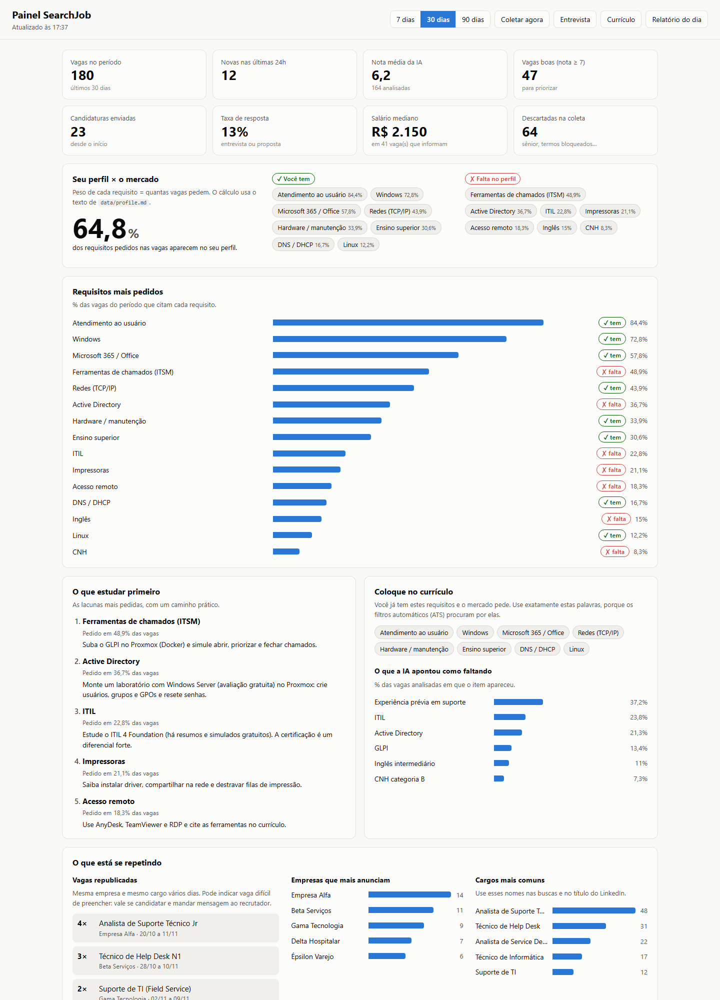
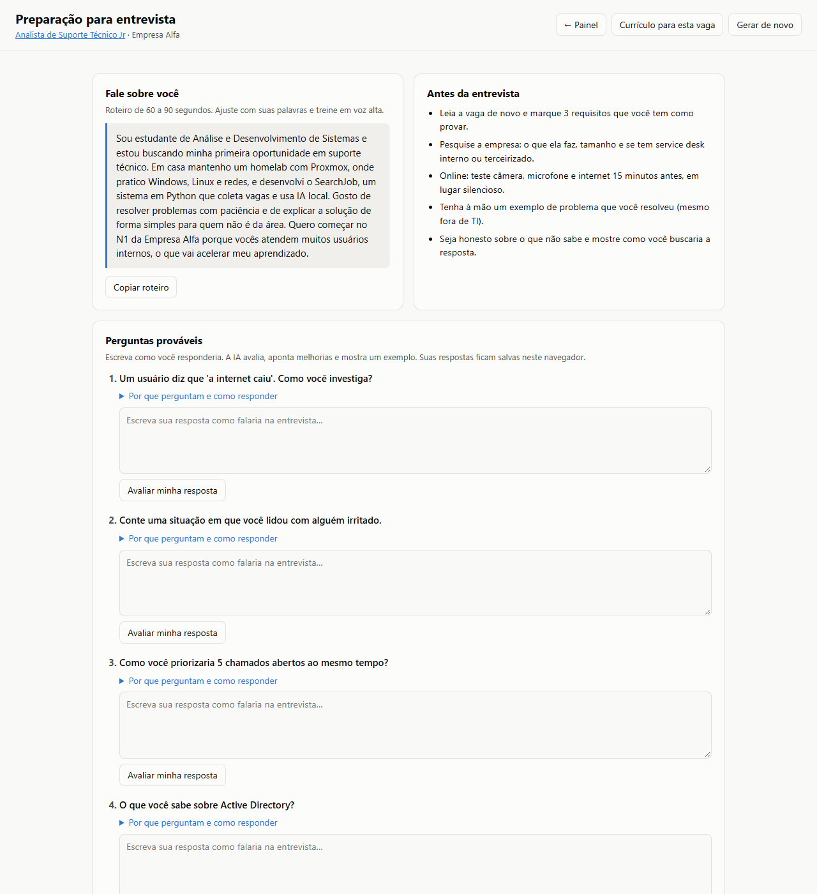
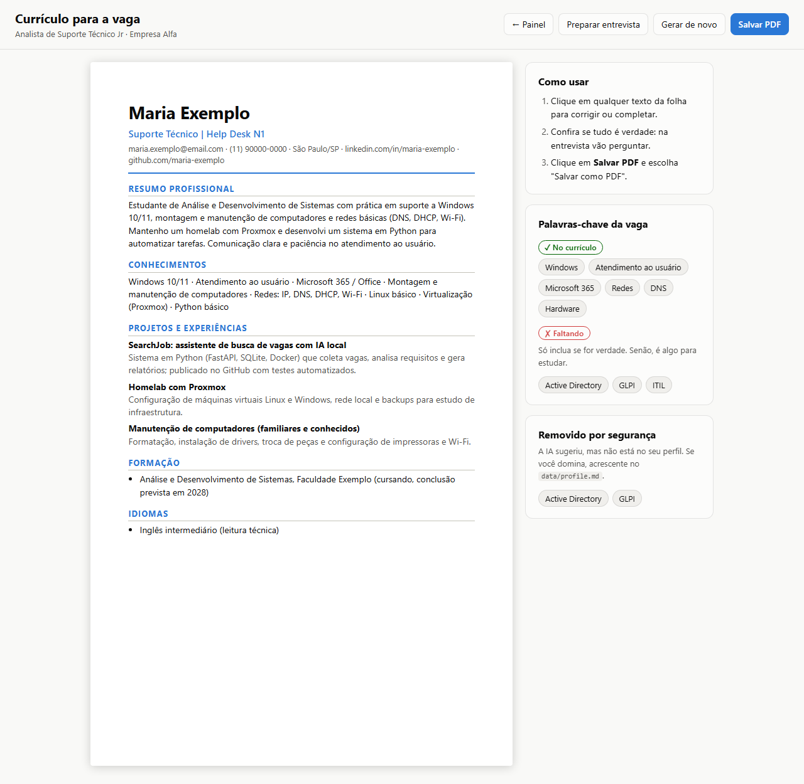
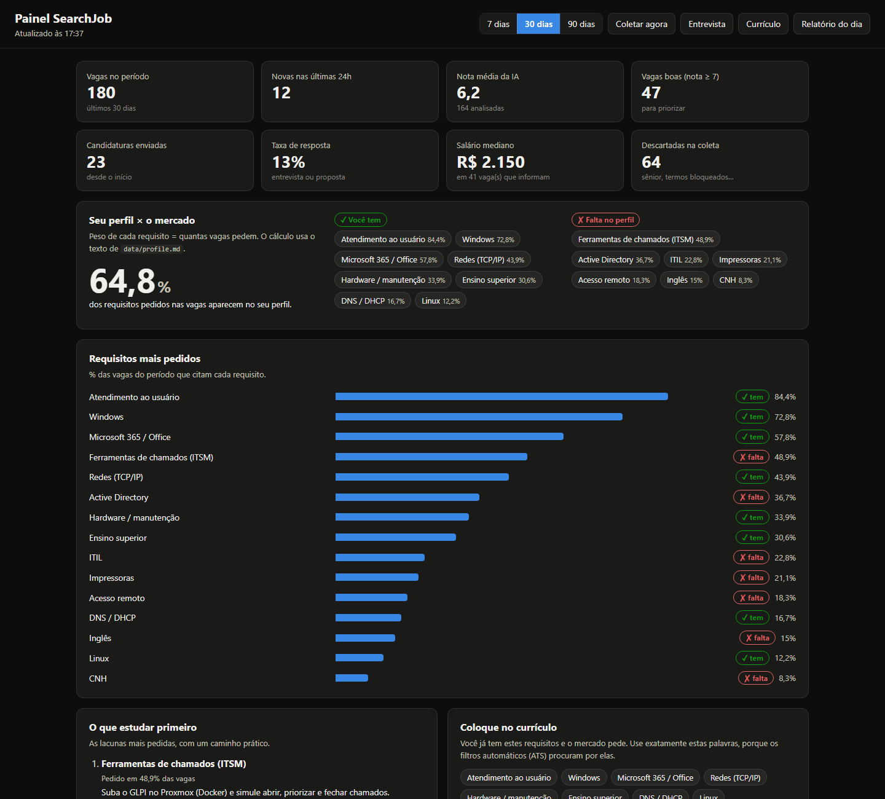
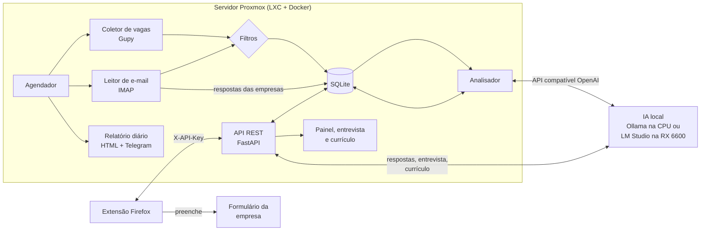

# SearchJob

[](https://github.com/ryanbworks/SearchJob/actions/workflows/ci.yml)


Assistente pessoal de busca de vagas de **suporte técnico, help desk e service desk**, com
**IA rodando localmente** (sem APIs pagas e sem enviar seus dados para terceiros).

Criei este projeto para organizar minha própria busca pelo primeiro emprego em TI. Ele
resolve quatro problemas reais:

1. **Achar as vagas certas.** Coleta vagas da Gupy e dos alertas por e-mail (LinkedIn,
   Indeed, InfoJobs, Catho), descarta as que não servem (sênior, muita experiência) e a IA dá
   uma nota de 0 a 10 de aderência ao meu perfil.
2. **Entender o que o mercado pede.** Um painel mostra quais requisitos aparecem com mais
   frequência, o que falta no meu perfil e o que estudar primeiro.
3. **Candidatar-se mais rápido e melhor.** Uma extensão do Firefox preenche os formulários
   repetitivos, e o sistema gera um currículo adaptado a cada vaga, sem inventar nada.
   A revisão e o envio continuam sendo meus.
4. **Chegar preparado na entrevista.** Para cada vaga, a IA lista perguntas prováveis e
   casos práticos de suporte, e avalia as minhas respostas de treino.

## Telas

> Capturas com **dados de exemplo** (pessoas e empresas fictícias).



<table>
  <tr>
    <td width="50%"></td>
    <td width="50%"></td>
  </tr>
  <tr>
    <td align="center"><sub>Preparação para entrevista</sub></td>
    <td align="center"><sub>Currículo adaptado por vaga</sub></td>
  </tr>
</table>

<details>
<summary>Painel no modo escuro</summary>


</details>

## Arquitetura



| Parte | Tecnologias | Pasta |
|---|---|---|
| Servidor | Python 3.12, FastAPI, SQLite, APScheduler, httpx, Jinja2 | [`server/`](server/) |
| Extensão | WebExtensions (Manifest V3), JavaScript puro, sem dependências | [`extension/`](extension/) |
| IA | Qwen2.5 / Llama 3.1 via Ollama, LM Studio ou llama.cpp (Vulkan) | [`docs/ia-local.md`](docs/ia-local.md) |
| Infra | Docker, Docker Compose, Proxmox LXC, GitHub Actions | [`docs/deploy-proxmox.md`](docs/deploy-proxmox.md) |

## Funcionalidades

**Servidor**
- Coleta periódica no portal público da Gupy, com paginação, intervalo entre requisições e
  remoção de duplicadas.
- **Alertas por e-mail** (IMAP, somente leitura): vagas do LinkedIn, Indeed, InfoJobs e
  Catho sem raspar esses sites, e **detecção de respostas das empresas** (convite para
  entrevista ou recusa), que atualiza o funil sozinha.
  Veja [`docs/alertas-email.md`](docs/alertas-email.md).
- **Filtro de vagas ruins:** descarta títulos sênior/pleno/coordenação e termos bloqueados,
  extrai a **faixa salarial** (ignorando benefícios) e marca vagas que pedem mais
  experiência do que o limite configurado.
- Extração de requisitos por palavras-chave (Windows, AD, redes, ITIL, GLPI…), que funciona
  mesmo sem IA.
- Análise com LLM local: nota de aderência, resumo, requisitos e o que falta no meu perfil.
  Se a IA estiver offline, a análise é adiada sem perder nada.
- **Painel web** (`/painel`): quanto do que o mercado pede o meu perfil cobre, o que estudar
  primeiro (com caminho prático), palavras-chave para o currículo, o que a IA apontou como
  faltando, vagas republicadas, empresas e cargos que mais aparecem, vagas por dia,
  distribuição das notas, funil de candidaturas e uma tabela de vagas com filtros e troca de
  status.
- **Preparação para entrevista** (`/entrevista`): perguntas prováveis com o que avaliam e
  dicas, casos práticos de suporte, roteiro do "fale sobre você" e avaliação das respostas
  de treino (nota, pontos fortes, melhorias e um exemplo).
- **Currículo adaptado por vaga** (`/curriculo`): a IA reorganiza o perfil pelo que a vaga
  pede; habilidades que não estão no perfil são **removidas automaticamente**. Folha A4
  editável com "Salvar PDF".
- Relatório diário em HTML com ranking das vagas e aviso opcional pelo Telegram.
- API REST documentada (OpenAPI em `/docs`), protegida por chave.
- Acompanhamento de status: nova → candidatado → entrevista → proposta / recusada.

**Extensão do Firefox**
- Reconhece campos por `label`, `aria-label`, `placeholder`, `name` e `autocomplete`,
  inclusive em formulários feitos com React/Vue.
- Preenche nome, contato, endereço, links, formação e pretensões a partir de um perfil
  salvo só no navegador.
- Destaca perguntas abertas e gera respostas com a IA local, com base no perfil e na vaga.
- Marca a vaga como "candidatado" no servidor e abre a preparação para entrevista e o
  currículo da vaga com um clique.

## Decisões de projeto

- **Sem candidatura automática.** A extensão nunca clica em "Enviar". Candidatura em massa
  costuma violar os termos dos sites e gera respostas genéricas, que recrutadores descartam.
- **Privacidade.** O perfil fica no navegador. CPF, RG e senhas não são armazenados. A IA
  roda na rede local, e os dados de contato do currículo nunca são enviados a ela.
- **IA sem invenção.** Os prompts proíbem inventar experiências, e o código confere a saída:
  habilidades do currículo que não estão no perfil são descartadas.
- **Permissões mínimas.** A extensão usa `activeTab`: só roda na aba atual e somente quando
  o usuário clica.
- **Fácil de estender.** Novas fontes de vagas só precisam implementar o protocolo
  `Collector` ([`collectors/base.py`](server/src/searchjob/collectors/base.py)).

## Começando

```bash
git clone https://github.com/ryanbworks/SearchJob.git
cd SearchJob/server
cp .env.example .env
cp data/profile.example.md data/profile.md
docker compose --profile ollama up -d --build
docker exec -it searchjob-ollama ollama pull qwen2.5:7b-instruct
docker compose exec searchjob searchjob cycle   # primeira coleta + análise
```

- Painel: `http://localhost:8000/painel` (pede a chave na primeira vez)
- Relatório: `http://localhost:8000/report?key=SUA_CHAVE`
- API: `http://localhost:8000/docs`
- Extensão: veja [`extension/README.md`](extension/README.md)
- Guia completo no Proxmox: [`docs/deploy-proxmox.md`](docs/deploy-proxmox.md)

## Testes

```bash
cd server && pip install -e ".[dev]" && pytest && ruff check .
cd extension && npm test
```

O CI (GitHub Actions) roda lint e testes do servidor, testes e `web-ext lint` da extensão e
o build da imagem Docker a cada push.

## Roadmap

- [x] Alertas de vaga por e-mail (LinkedIn, Indeed, InfoJobs, Catho)
- [x] Currículo adaptado por vaga
- [x] Preparação para entrevista
- [ ] Lembrete de follow-up para candidaturas sem resposta
- [ ] Suporte a Outlook/Hotmail (OAuth) na leitura de e-mails

## Licença

[MIT](LICENSE)
