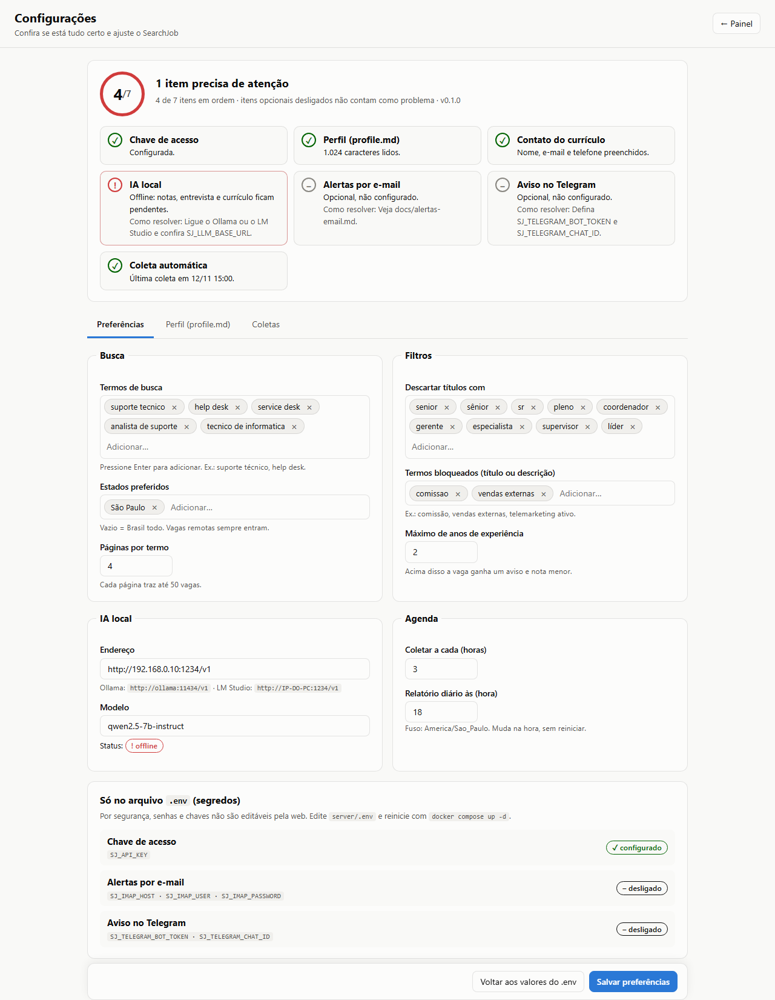

# Configuração

O SearchJob tem **três lugares** de configuração. Quase tudo pode ser feito pela aba
**⚙ Configurações** do painel (`/configuracoes`).

| Onde | O que fica lá | Como mudar |
|---|---|---|
| Aba **Configurações** → *Preferências* | busca, estados, filtros, IA, agenda | pelo navegador; vale na hora |
| Aba **Configurações** → *Perfil* | `data/profile.md`: seu perfil e o contato do currículo | editor com prévia; vale na hora |
| Arquivo `server/.env` | senhas e chaves (API, e-mail, Telegram) | editar o arquivo e reiniciar |
| Opções da extensão do Firefox | dados para preencher formulários, endereço e chave do servidor | popup → "Editar perfil e servidor" |

## A aba Configurações



> Captura com dados de exemplo.

No topo, uma **verificação** mostra o que está em ordem e o que precisa de atenção, já com
a dica de como resolver:

| Item | Fica ✓ quando… |
|---|---|
| Chave de acesso | `SJ_API_KEY` tem 16 ou mais caracteres |
| Perfil | existe `data/profile.md` (não o de exemplo) |
| Contato do currículo | nome, e-mail e telefone estão no bloco `---` do perfil |
| IA local | o servidor de IA responde |
| Alertas por e-mail | IMAP configurado (opcional) |
| Aviso no Telegram | bot configurado (opcional) |
| Coleta automática | houve coleta recente |

Itens opcionais desligados aparecem com "–" e não contam como problema.

### Preferências

As preferências salvas aqui ficam em `data/preferences.json` e **sobrepõem o `.env`**. Elas
passam a valer na hora, inclusive o intervalo de coleta e a hora do relatório. O botão
**"Voltar aos valores do .env"** apaga esse arquivo.

| Campo | Variável equivalente no `.env` | Padrão |
|---|---|---|
| Termos de busca | `SJ_SEARCH_TERMS` | suporte tecnico, help desk, service desk, analista de suporte, tecnico de informatica |
| Estados preferidos | `SJ_PREFERRED_STATES` | vazio (Brasil todo) |
| Páginas por termo | `SJ_MAX_PAGES_PER_TERM` | 4 |
| Descartar títulos com | `SJ_EXCLUDE_TITLE_TERMS` | sênior, pleno, coordenador, gerente, especialista, supervisor, líder… |
| Termos bloqueados | `SJ_BLOCKED_TERMS` | vazio |
| Máximo de anos de experiência | `SJ_MAX_EXPERIENCE_YEARS` | 2 |
| Endereço da IA | `SJ_LLM_BASE_URL` | `http://localhost:11434/v1` |
| Modelo | `SJ_LLM_MODEL` | `qwen2.5:7b-instruct` |
| Coletar a cada (horas) | `SJ_COLLECT_EVERY_HOURS` | 3 |
| Relatório às (hora) | `SJ_REPORT_HOUR` | 18 |

### Perfil (`data/profile.md`)

Editor com **prévia do Markdown** ao lado. É o texto que a IA lê para dar notas, preparar a
entrevista e montar o currículo, e que o painel usa no "seu perfil × mercado".

```markdown
---
nome: Seu Nome Completo
email: seu.email@exemplo.com
telefone: (00) 00000-0000
cidade: Sua Cidade/UF
linkedin: linkedin.com/in/seu-perfil
github: github.com/seu-usuario
---
# Perfil

## Formação
- Curso, instituição (cursando, conclusão prevista em AAAA)

## Conhecimentos
- Windows 10/11: instalação, formatação, drivers
- Redes básicas: IP, DNS, DHCP, Wi-Fi

## Projetos
- Nome do projeto: o que você fez

## Idiomas
- Inglês (nível real)
```

- O bloco entre `---` é usado **só no cabeçalho do currículo** e nunca é enviado à IA.
- As seções **Formação** e **Idiomas** entram no currículo exatamente como você escreveu.
- Escreva só o que é verdade: o currículo gerado remove habilidades que não estão aqui.

### Coletas

Histórico dos últimos 7 dias: vagas encontradas, novas, descartadas pelos filtros, analisadas
pela IA e erros.

## Só no `.env` (segredos)

Por segurança, estes valores **não** são editáveis pela web. A aba mostra apenas se estão
configurados.

| Variável | Para quê |
|---|---|
| `SJ_API_KEY` | chave de acesso do painel e da extensão |
| `SJ_LLM_API_KEY` | chave do servidor de IA, se ele exigir |
| `SJ_IMAP_HOST`, `SJ_IMAP_USER`, `SJ_IMAP_PASSWORD` | leitura dos alertas por e-mail ([guia](alertas-email.md)) |
| `SJ_IMAP_FOLDER`, `SJ_IMAP_DAYS` | pasta e quantos dias para trás ler |
| `SJ_TELEGRAM_BOT_TOKEN`, `SJ_TELEGRAM_CHAT_ID` | aviso diário no Telegram |
| `SJ_TIMEZONE` | fuso horário (padrão `America/Sao_Paulo`) |
| `SJ_SCHEDULER_ENABLED` | liga/desliga a coleta automática |

Depois de editar: `docker compose up -d` (dentro de `server/`).

## Extensão do Firefox

No popup da extensão, clique em **"Editar perfil e servidor"** (ou `about:addons` →
SearchJob → Opções):

- **Perfil para formulários:** nome, contato, endereço, links, formação, pretensão e resumo.
  Fica salvo só no navegador. CPF e RG não são guardados.
- **Servidor:** endereço (ex.: `http://192.168.0.50:8000`) e a mesma `SJ_API_KEY`.
- **Sobrescrever campos já preenchidos:** desligado por padrão.
